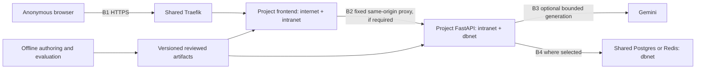

# Architecture and shared acceptance requirements

Normative companion to all 12 project specifications. Canonical source: [Oswaldo's architecture skill](/home/iktdts/.agents/skills/architecture/SKILL.md), read September 24, 2026. The choices below apply that skill to this set of public portfolio apps. A project document can narrow functionality; it cannot silently remove these applicable controls.

## Stack and decisions

| Layer | Decision |
|---|---|
| Frontend | Next.js 16+ App Router, TypeScript strict with ES2017 target, Tailwind v4, Node 24 Alpine multi-stage image |
| Browser state | URL for shareable selection; local React state; Zustand only for complex linked-view state; native fetch unless server-state caching warrants React Query |
| Visualization | SVG for small graphs/matrices, canvas for dense point fields, semantic HTML tables as equivalent access; rendering chosen per project |
| Backend | FastAPI/uvicorn async on Python 3.13 slim only for the four explicitly designated backend projects |
| Database | Only retrievallab requires PostgreSQL 18 with pgvector, using the shared infrastructure instance |
| Redis | Only extractworkbench and promptstudio require the shared Redis 7 instance initially, for atomic provider budgets and session isolation |
| Models | Gemini through google-genai for hosted generation; no LangChain. Offline educational models and embeddings are locally generated artifacts, not hosted Gemini replacements |
| Public auth | None for public read/explore surfaces. Server-issued anonymous sessions for the two bounded model apps. No admin web UI in MVP |
| API | Same-origin REST through a fixed project-prefixed backend destination; no GraphQL/tRPC |
| Build/deploy | Docker Compose, separate projects, two-env deploy convention, shared Traefik TLS ingress |
| Tests | Vitest + React Testing Library, Playwright, and pytest/pytest-asyncio where Python/backend logic exists; root test.sh |

Next.js is chosen even for the visualization apps because each has crawlable methodology, per-project social metadata, and a shareable public entry point. The skill permits Vite for pure visualization but does not require it. Do not introduce a second frontend runtime. Lazy-load the exploration surface. Pin exact dependency versions and commit lockfiles during implementation; the versions above are architecture requirements, not a claim that any particular patch is current or secure.

Each project gets its own checkout, service prefix from README.md, and independently configurable PROJECT_HOST. Suggested test convention is `<prefix>.home.iktdts.com`; it is not a DNS reservation. Production hostnames must come from the project's deployment configuration. Do not invent a production domain or modify DNS while implementing the specification.

No project needs a Discord bot, Celery/RQ worker, Kubernetes, a monorepo tool, or an always-running training service. Training, full evaluations, indexing benchmarks, and projection exports happen in explicit authoring commands on development hardware. Backend requests must be bounded; CPU work uses a bounded executor rather than blocking the async event loop.

## Components and trust boundaries

Frontend-only projects omit API, Model, and DB runtime components. Offline Python tools are development dependencies. Backends never join internet or publish host ports. Frontends join internet and intranet; backend services join intranet and dbnet. Shared external networks are provisioned by infrastructure, not created by these projects. Postgres, Redis, and Traefik never appear as new services in an app's Compose file. All app service names and internal DNS names are project-prefixed. Generic `backend` and `frontend` DNS aliases are prohibited.

Container defaults: non-root `${APP_UID}:${APP_GID}`, read-only root filesystem, cap_drop ALL, no-new-privileges, pids_limit 200, restart unless-stopped, explicit memory limit. Frontend starts at 512 MiB with bounded writable tmpfs for /tmp and Next cache. Backend starts at 512 MiB, except retrievallab's resident embedding model has a documented initial 1536 MiB cap to be validated under load. Only declared runtime data paths are writable; model/artifact inputs are read-only. No runtime Remotion rendering, model downloads, or training. Asset generation runs off-host. If a service must scale, remove fixed container_name and use shared rate-limit/session storage first.

## Configuration, persistence, and deployment

Commit .env.example, npm lockfiles, pinned Python dependencies where used, and a root Compose file. Ignore runtime .env, .env.local, .env.prod, .env.test, secrets/, secrets.prod/, secrets.test/, and runtime data/. Keep public reproducibility fixtures outside the ignored runtime-data directory. Use the canonical top-level frontend/backend/scripts/data distinction; omit backend when absent. Internal router/class/file organization belongs to the implementing agent.

Use secrets mounted at /run/secrets, read by one backend helper before a local-development env fallback. Never pass DB passwords or provider keys to the frontend. Secrets in Compose come from files, never literal env values. Redis deployments use a project-scoped ACL identity where infrastructure supports it; credentials are Docker secrets. Otherwise document the infrastructure dependency before enabling live model calls. Never copy latentSource's credentials.

For retrievallab, role = database = schema = `retrievallab`. All application and migration tables live there; revoke CREATE on public. Ship idempotent scripts/setup_db.sh and forward-only SQL migrations for asyncpg. Provision using the infra admin connection, then connect at runtime only as the restricted app role. Pin search_path on each pooled connection, serialize startup migrations with a database lock, and fail startup on migration errors. No destructive production migration or extension upgrade is implied by these documents.

Deployment follows deploy.sh target, checkdeploy.sh, environment materialization, code sync, test gate, and Compose from the skill. Test precedes production. Inspect running Compose labels before replacing a deployment and preserve overrides, secrets, mounted artifacts, and unrelated services. Build off-host when memory is insufficient, with the destination's own public arguments and UID/GID. The spec does not authorize a deployment. Keep previous image/artifact versions and a rollback procedure. Database changes must be backward compatible across the rollback window.

## Common public interface

Every app has `/` (purpose and working entry point), `/explore` (primary interaction), and `/methodology` (inputs, transformations, provenance, limitations, reproduction instructions). English uses those unprefixed routes; Spanish uses `/es` equivalents. Localized pages share artifact IDs and numerical results. Provide English and Spanish navigation, controls, errors, methodology summaries, and social metadata using next-intl; source records remain in their original language. No machine-translated replacement of source quotations or model inputs without explicit labeling.

Match latentSource's restrained navy/slate/sky/paper palette. Use bespoke vector marks and readable charts. Preserve the existing article-card SVG style when linking back to the blog. Real evidence figures and charts must be generated from data. Any decorative media is programmatic, rendered at authoring time, and respects reduced motion. No autoplay, unnecessary 3D, or animation essential to understanding a result.

Keyboard interaction, visible focus, table/list equivalents, accessible chart descriptions, non-color selection cues, and 390px mobile layouts are required. Announce computation status without flooding assistive technology. Escape HTML in imported text. Use in-page errors/confirmations; never native alert/confirm/prompt/window.open. Empty selections, invalid URLs, stale results, unavailable artifacts, and canceled work need explicit states. Downloads use a safe filename and versioned content; CSV exports neutralize spreadsheet formulas.

URL state contains bounded, nonsensitive selection/configuration values and artifact version. Never put user document text, prompts, outputs, secrets, or arbitrary fetch URLs in a shared link. Parse against an allowlist, reject oversized state, and reset invalid fields with an explanation. No arbitrary URL imports in MVP. A dataset version mismatch must not silently reinterpret saved IDs.

## Data and result contracts

Every public dataset/model/evaluation bundle includes a schema_version, artifact_id/version, created_at, source identifiers, content hashes, license/reuse status, preparation command, exact package/model revisions, seeds, units, record counts, and limitations. Arrays use stable string IDs. Numbers must be finite; missing values are null with a reason. Preserve original vectors and source rows separately from display coordinates or transformed features.

Distinguish measured outputs, synthetic inputs, simulations, estimates, and saved runs in the UI. Do not relabel illustrative article JSON as experimental evidence. A new computation carries configuration, input/artifact hashes, timing scope, and algorithm version. Reproducibility means deterministic data and documented numeric tolerance within the pinned environment; never promise identical floating-point artifacts across all hardware.

Artifacts are validated before publishing and on load. Ship a small known-good bundle with the app. Larger bundles load only when selected. A manifest version and checksum prevent mixing files from different runs. A first release must work with its default bundle without a user account or paid provider connection. Live features in 07/10 supplement that baseline and are clearly labeled.

REST responses use explicit typed schemas. Errors return a stable code, a safe message, and request_id; no stack trace, SQL, prompt contents, or filesystem paths. Read pagination defaults to 25, maximum 100. Validate project-specific caps before expensive work. Use 422 for invalid configuration, 413 for oversized bodies, 429 with Retry-After for budgets/rate limits, 503 for unavailable dependencies, and 504 for bounded timeouts. No automatic retries of paid calls.

## Threat model and required controls

| Boundary | Relevant threats | Required control | Later validation |
|---|---|---|---|
| B1 public to frontend | Host abuse, XSS, oversized state, CPU exhaustion, crawler exposure | TLS; host allowlist; nonce CSP and security headers; escaped content; URL/artifact caps; worker cancellation; published-only metadata | security-audit, geo-audit |
| B2 frontend to API | Open proxy, oversized bodies, request flooding, stale compute | Fixed backend destination; allowlisted routes/methods; body caps; always-on slowapi; bounded executor and correlation IDs | security-audit, perf-audit |
| B3 model boundary, only 07/10 | Cost abuse, injection, unsafe output, session crossover | Complete LLM contract below; no tools; output/schema validation; atomic budgets | security-audit AI/LLM pass |
| B4 datastore | SQL injection, cross-project reads, credentials, budget races | Bound parameters, own schema/role, secret files, atomic Redis operations and project key prefixes | security-audit |
| Authoring to bundle | Poisoned records, draft/private data, fabricated evidence | Explicit source allowlist, rights checks, hashes, schema validation, source/result separation | Data acceptance tests and review |
| Container to host | Privilege escalation, cross-project impact | Non-root, hardening, resource limits, networks and mounts scoped as above | security-audit |

Every FastAPI service includes security headers, bounded always-on slowapi, TrustedHost, explicit CORS, GZip, safe production errors, and disabled production docs/redoc/openapi endpoints. Default public API rate limit is 60/min/IP; compute endpoints 10/min/IP; model endpoints 5/min/IP. Trust forwarded client IP only through the actual known proxy chain. Healthchecks are inexpensive and never call a model or execute a benchmark. The TrustedHost allowlist includes the configured public host, the exact project backend hostname, and the loopback host used by its healthcheck; do not use a wildcard to make internal checks pass.

The frontend request middleware/proxy is the sole owner of page CSP and security headers. Use the installed Next.js version's supported entry point, per-request nonce, and same-origin connect-src for the API path. No second static CSP in next.config. HSTS, nosniff, frame denial, strict-origin referrer policy, and disabled camera/microphone/geolocation are required. Nonce-bearing HTML must not be shared-cached across requests; this is the explicit exception to static HTML defaults. Cache the public content/artifact payloads and hashed assets, not a reusable nonce document.

## Hosted-model contract for 07 and 10

Use one configured, provider-supported Gemini model ID, verified and pinned in release metadata. The implementation agent must check current provider availability and supported schema features before capturing fixtures. No runtime model selector or automatic provider fallback. Use google-genai directly. Prompt instructions are versioned Markdown files; source/user data occupies a separate content role and is labeled untrusted data. No external tools, browsing, filesystem access, or SQL generation.

Apply a 16 KiB HTTP body limit, then NFKC/control/padding normalization and per-project character caps. Display the normalized submitted text if normalization changes it. A rough len/4 estimate is diagnostic only: use countTokens or a conservative tokenizer-aware bound to enforce the 2048 user-input-token cap, plus a 4096-token cap on the full request including system/schema. Count-token requests also have deadlines and rate limits. Never claim a character cap alone prevents CJK/emoji token overflow. [Provider token accounting](https://ai.google.dev/gemini-api/docs/tokens).

Run the fail-closed guard before every main call, after budget reservation. The guard returns a validated `{allow: boolean, reason_code: string}` with a server-owned reason-code enum. Malformed output is a refusal. Its task is to reject unsafe requested behavior while treating quoted source instructions as data; it does not authorize tools or weaken downstream limits. Guard output cap 128 tokens and timeout 5 seconds; main output cap 1024 and timeout 20 seconds. Prompt-studio comparison is two sequential main calls with a total 50-second deadline. Any guard error/refusal prevents its main call. All calls, including guards, consume the budget. On disconnect attempt upstream cancellation and retain reservation until reconciliation or conservative charge. Retry only by an explicit new user action with a new reservation.

Issue a cryptographically random server-validated session with 30-minute TTL, carried in secure/httpOnly/SameSite=Lax cookie plus a CSRF token/header for POST. Client-supplied IDs never grant access. One in-flight operation per session, two per IP, five project-wide. Redis atomically reserves worst-case tokens/calls before invoking providers and reconciles actual usage afterward; unknown usage stays fully charged. Sessions get 20 model calls/20,000 tokens per hour, IPs 40 calls/40,000 tokens per hour, project 500 calls/500,000 tokens per rolling 24 hours. Guard calls count as calls. Exceeding a limit locks out paid work until that window resets. Make limits configurable downward. Redis failure disables live calls with 503; saved examples remain available. Rate-limit session issuance to 10/min/IP and bound the total live-session key inventory with TTL eviction; reject new sessions rather than allow unbounded storage. Keep only quota/session counters in Redis, not raw user text or outputs. Browser outputs stay in memory until reset/navigation; no server history API or cross-session result cache.

Validate provider output as untrusted data; no raw HTML rendering, eval, arbitrary link fetching, or server execution. No full prompts, source text, outputs, cookies, or IP addresses in ordinary logs. Log request IDs, timings, model/config IDs, usage, and safe error codes. Anonymous user content is sent to the named provider only after an explicit Run action and an in-page explanation; do not promise zero provider retention.

## Build order and definition of done

1. Read the selected article sources and inventory. Choose a new standalone project checkout and record resolved stack/components from its spec.
2. Establish project-prefixed Compose, env templates, ignored secrets/data, dependency locks, resource limits, and network topology.
3. Prepare the default dataset/model/fixtures and their manifests. Verify the math and expected values before building charts.
4. Provision/migrate only where required. Build bounded backend contracts and middleware before exposing them.
5. Build the explorable interface, methodology, URL state, accessibility, and loading/error/cancellation states.
6. For model projects, implement and test the entire provider contract before enabling live requests.
7. Add public metadata, social PNG, robots Content-Signal policy (`search=yes, ai-input=yes, ai-train=no`), sitemap with real content dates, and readable methodology. Publish llms.txt for methodology/data documentation. Exclude private/session endpoints from discovery. JSON-LD must describe the actual application/author, not invent articles or organizations.
8. Run root test.sh with Vitest, Playwright, and applicable Python tests. For frontend-only apps, backend test selection reports not applicable; offline Python algorithms still get pytest checks. Do not invent a backend to satisfy a test folder convention. No docker-compose.test.yml.
9. Deliver a reproduction guide, passing acceptance evidence, measured performance, deployment templates, and rollback instructions. Later, when authorized, deploy test then production and suggest full-audit for live validation.

Every project must satisfy its numbered acceptance criteria plus these common gates: default scenario works without credentials; fresh installation reproduces its fixtures; all applicable security/topology controls are present; desktop/mobile/keyboard/reduced-motion checks pass; no silent data/version mixing; and no benchmark or model-quality claim exceeds its evidence.

Performance targets, measured on Chrome with 4x CPU slowdown and a documented fast-4G profile: meaningful initial content within 2.5 seconds, CLS under 0.1, visible interaction acknowledgement within 100 ms, no chart computation blocking the main thread beyond 100 ms. Initial compressed JS target under 350 KiB; load model/plot bundles on demand. Record actual payload and timing results and explain any miss rather than claiming this specification is a measurement. Static hashed assets use immutable one-year caching; manifests use revalidation; session/provider responses are no-store.
