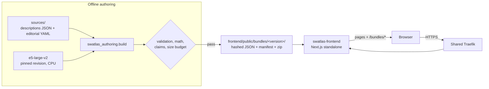

# Architecture

swatlas has two halves. They share nothing at runtime except a versioned, checksummed data bundle:

1. An **offline authoring pipeline** (Python, `scripts/authoring/`). It embeds the descriptions, computes every score and projection, checks the article's claims, and writes the bundle.
2. A **static-data web app** (Next.js, `frontend/`). It serves the bundle as immutable files and does all exploration in the browser.

The complete public data flow is browser → frontend → reviewed bundle. There is no backend service, database, cache, auth, or model call at runtime.



## Repository layout

```
frontend/
  app/[locale]/           pages: / (home), /explore, /methodology, catch-all 404, OG image
  app/api/health/         liveness endpoint (never reads the bundle)
  app/robots.txt, sitemap.ts, llms.txt/   discovery routes built from the bundle
  components/explorer/    interactive explorer (views, panels, Zustand store, spring layout)
  components/atlas/, site/  preview map, JSON-LD, header/footer, locale switch
  lib/atlas/              bundle schema, loading and checksum checks, neighbor/graph/filter math,
                          URL state, CSV export, text diff
  i18n/, messages/        next-intl routing and en/es strings
  proxy.ts                per-request CSP nonce and security headers
  public/bundles/         published data bundles (the only data source)
  __tests__/, e2e/        Vitest and Playwright suites
scripts/
  build_bundle.sh         entry point for bundle generation
  authoring/              uv project: sources/, swatlas_authoring/ package, tests/
docker-compose.yml        one hardened service behind Traefik
test.sh                   python | frontend | e2e | backend (n/a) | all
```

## Authoring pipeline

`scripts/build_bundle.sh` sets `PYTHONHASHSEED=0` and single-threaded OMP/MKL/Numba, runs `uv sync --frozen`, then calls `swatlas_authoring.build`. The modules:

| Module | Role |
|---|---|
| `config.py` | Every value that affects the published numbers: model ID and revision, input prefix, UMAP parameters and seeds, default threshold (0.87), size budget (500 KiB gzipped), paths |
| `extract.py` | Parses the `characters = {...}` block from the article's Python code into `article_descriptions.v1.json` (verbatim, with line references) |
| `sources.py` | Loads the descriptions and `editorial.v1.yaml`, and enforces exactly 15 unique IDs, controlled vocabularies, relationship endpoints, variants for every character, and complete source references |
| `compute.py` | Embedding, L2 normalization, norm checks (no zero vectors), cosine matrix, neighbor ordering, threshold pairs, PCA and UMAP |
| `claims.py` | Evaluates the article's 14 narrative claims against the original-space matrix, per description mode, with the evidence for each verdict |
| `build.py` | Orchestration: builds both description modes, writes content-hashed files, the manifest, a deterministic zip and `index.json`, and fails on any check or budget violation |

For each of the two **description modes**, the pipeline follows the same steps:

1. **Hash the input.** It computes an input hash over the ordered IDs, the texts and the model revision. The two modes must hash differently.
2. **Embed.** Each description is encoded separately (batch size 1) on CPU with `torch` deterministic algorithms and the `passage: ` prefix E5 expects.
3. **Normalize.** Vectors are L2-normalized in the pipeline, not by the model, and rounded to 9 decimals for export. The build fails if any norm drifts from 1.
4. **Score.** It computes cosine similarity as the dot product of the normalized vectors. The build checks that the matrix is symmetric, has a unit diagonal and has only finite values.
5. **Project.** It runs PCA and UMAP with seeds 7, 21 and 42 (n_neighbors 5, min_dist 0.3, cosine metric, `n_jobs=1`). The coordinates are exported as they are.

The two modes are:

- **authored:** the article's verbatim descriptions.
- **relationships_removed:** a hand-written variant of each description with named relationship phrases removed. Identity aliases such as "formerly Ben Solo" are kept.

Reproducibility comes from the pinned dependency lock and the recorded execution settings. The claim is deterministic output within the pinned environment on the same hardware, verified by rebuilding to byte-identical hashes. It is not bit-identical floats across all hardware.

## Bundle contract (schema v1)

`frontend/public/bundles/index.json` lists the published versions and the `default_version`. Each version directory holds:

| File | Content |
|---|---|
| `manifest.json` | Schema version, artifact ID and version, `created_at`, source article and file hashes, license and reuse terms, model ID, revision and dimensions, per-mode input hashes, projection parameters, computation rules, counts, exact package versions, execution settings, the preparation command, limitations, and every file's path, sha256 and size |
| `characters.<hash>.json` | `{id, name, description, description_variant, variant_note, allegiances[], roles[], eras[], force_status, classification_note, source_ref, review_status}` plus the controlled vocabularies |
| `relationships.<hash>.json` | 21 curated directed edges `{from, to, type, source_ref, note}`, each quoted from a description. They carry no similarity score |
| `similarity.{authored,variant}.<hash>.json` | Ordered `ids`, the 15×15 cosine `matrix`, and summary statistics |
| `projections.{authored,variant}.<hash>.json` | `{id, method, dimensions, parameters, seed, coordinates_by_id}` for `pca`, `umap-7`, `umap-21` and `umap-42` |
| `vectors.{authored,variant}.<hash>.json` | 1024-d normalized vectors keyed by character ID (download only, not loaded by the explorer) |
| `claims.<hash>.json` | Each claim's quote, the test applied, and the outcome with evidence per mode |
| `swatlas-<version>.<hash>.zip` | Descriptions, vectors, scores, projections, parameters and a README |

File names embed the first 12 hex characters of the sha256, so hashed files are immutable and cached for a year. `index.json` and `manifest.json` are revalidated on every request. Arrays use stable string IDs, and the row order of vectors and matrices is given by the explicit `ids` list.

## Frontend

### Pages and rendering

- `/` introduces the app with a server-rendered preview map. `/explore` is the explorer. `/methodology` shows the inputs, transformations, provenance, limitations, the claim table and reproduction steps.
- English routes are unprefixed and Spanish routes use `/es/...`. next-intl runs with `localePrefix: 'as-needed'`, locale detection off and no locale cookie, so the URL is the only locale state. The UI is translated, but the source descriptions stay in English.
- Server pages, `sitemap.xml` and `llms.txt` read the default bundle from disk through `lib/atlas/server.ts`, with the same checksum and schema checks the browser applies.
- The explorer is a client-only component, lazy-loaded with `next/dynamic`, so its JavaScript loads only on `/explore`. The page shell and noscript fallback are rendered on the server.

### Loading and verification

`lib/atlas/bundle.ts` loads data in this order:

1. Fetch `index.json` and resolve the requested version. An unknown or malformed `?v=` shows a recoverable "unavailable version" state that lists the available versions.
2. Fetch the version's manifest.
3. Fetch only the files the explorer needs: characters, relationships, both similarity files and both projection files (about 9 KiB gzipped).
4. Check each file's sha256 against the manifest. SubtleCrypto is used where available, with a pure-JS fallback so the check is never skipped.
5. Validate each file with zod and assemble one consistent `Atlas`.

Checksum, schema, consistency and network failures each have their own error code and in-page message. Files from different versions are never mixed.

### State and URL

A Zustand store (`components/explorer/store.ts`) holds the linked-view state: selection, hover, view (`map`, `graph`, `matrix`), projection, description mode, threshold, filters, curated edges on or off, and color-by. `lib/atlas/urlState.ts` serializes that state into the query string and parses it against an allowlist:

- The whole query is capped at 1024 characters, and each filter at 12 values.
- The threshold is clamped to [-1, 1] and rounded to 0.01.
- An invalid field resets to its default with an explanation. An unknown character ID shows an error and selects no one, rather than silently picking someone else.
- When no threshold is in the URL, the default comes from the bundle manifest. Different models score on different ranges.

### Computation in the browser

All math reads the full original-space matrix of the active mode (`lib/atlas/neighbors.ts`, `graph.ts`, `filters.ts`):

- Neighbors exclude the character itself, sort by descending score and break ties by ascending ID.
- Filters hide characters and recompute the visible neighbor list from the same matrix. They never refit a projection.
- Graph edges are the unordered pairs with score ≥ threshold. A threshold with no qualifying pairs is a valid, explained empty state.
- Projections only supply coordinates. Switching PCA or UMAP cannot change a ranking.

### Views and interaction

- The map and the graph are SVG. The graph uses the selected projection's fixed coordinates, not a force layout, so nothing moves on load. `useLiveLayout` adds optional dragging: each point springs back toward its home position, and each drawn link acts as a spring, so linked points follow. Under `prefers-reduced-motion` there is no entrance animation and the link springs are off. Dragging only changes screen positions.
- The matrix is an SVG heatmap with grid keyboard navigation and a semantic `<table>` equivalent. The character list is a keyboard-operable listbox, so the whole task can be done without a pointer.
- Colors show faction (derived from the draft allegiances and roles) or Force status. Selection is also shown with a thick ring, a bold label and a "selected" tag, and neighbors get numbered rank badges, so color is never the only cue.
- In description mode, the details panel shows a word diff between the authored and variant text (`lib/atlas/diff.ts`) and each neighbor's rank in the other mode.
- Downloads: the per-version evidence zip, and a CSV of the current neighbors (`lib/atlas/csv.ts`) with a safe filename and spreadsheet-formula neutralization.

## Security

The only runtime trust boundary is the public internet to the frontend. The second boundary is authoring to the bundle, where poisoned or unreviewed data could get in.

- **Headers.** `proxy.ts` is the only place that sets page CSP and security headers. Each request gets a CSP with a fresh nonce and `strict-dynamic`, same-origin `connect-src`, `frame-ancestors 'none'` and `object-src 'none'`. It also sets HSTS, `nosniff`, `X-Frame-Options: DENY`, a strict-origin referrer policy, and a Permissions-Policy that disables the camera, microphone and geolocation. Nonce-bearing HTML is `private, no-store`. The bundle files and hashed assets stay publicly cacheable.
- **Data handling.** All imported text is rendered as escaped React text, and no markup from the data runs. URL state is allowlisted and size-capped, and holds only IDs and settings.
- **No outbound requests.** The site makes no third-party requests. A Playwright test aborts every cross-origin request and confirms the explorer still works.
- **Robots and discovery.** `robots.txt` publishes `Content-Signal: search=yes, ai-input=yes, ai-train=no` and disallows `/api/`. `/api/health` is cheap and never touches the bundle.
- **Authoring gate.** Sources come from an explicit allowlist (the vendored article descriptions and the editorial YAML). Draft editorial data is labeled in the data and in the UI. Measured outputs are marked `kind: measured-output`, separately from the hand-authored fields.

## Container and deployment

- **Image.** `frontend/Dockerfile` is a multi-stage build on a digest-pinned `node:24-alpine`: `npm ci`, then `next build` with `output: 'standalone'`, then a runner stage that copies only the standalone server, static assets and `public/`. The build fails if no bundle is present. The runtime runs as `node` with a `wget` health check on `/api/health`, and contains no model, Python or download step.
- **Service.** `docker-compose.yml` runs one service, `swatlas-frontend`, with these settings:
  - runs as `${APP_UID}:${APP_GID}` with a read-only root filesystem
  - `cap_drop: ALL`, `no-new-privileges`, `pids_limit: 200`, 512 MiB memory, 1 CPU
  - bounded tmpfs for `/tmp` (64 MiB) and `/app/.next/cache` (128 MiB)
  - `restart: unless-stopped`
- **Networking.** The service joins the external `internet` and `intranet` networks and exposes port 3000 only to Traefik. Traefik labels route `Host(${PROJECT_HOST})` over TLS and redirect HTTP to HTTPS permanently.

## Testing

| Suite | Location | Covers |
|---|---|---|
| pytest | `scripts/authoring/tests/` | 15 unique IDs, both variants, source references, draft marking, vendored text equal to the article. Independent NumPy (`einsum`) recomputation within 1e-6, symmetry, unit diagonal, norms, finiteness. Projections differ while neighbors stay the same. The variant changes the input hash and exactly the edited vectors. Threshold pair counts equal matrix filtering. Manifest hashes, size budget, tie-breaking, curated edges without scores |
| Vitest | `frontend/__tests__/` | Neighbor, graph and filter math against the shipped bundle. URL allowlist, round-trip and oversized or unknown input. CSV neutralization, safe filenames, pure SHA-256 matching SubtleCrypto, tampered-file rejection, listbox and grid keyboard behavior, escaping of hostile text |
| Playwright + axe | `frontend/e2e/` | Default state, and rankings on screen equal to the bundle matrix. View and projection switches keep the selection. Threshold 1 gives matrix-derived edges. Variant hash and diff, filters, URL reload reproducing every field, copy and reset, recoverable unknown ID and version, keyboard-only flow. Zero external requests. WCAG 2.1 AA and no horizontal scroll at 390px. Security headers and nonce CSP, robots, sitemap, llms.txt, health, cache headers, OG image |

`./test.sh all` runs all three suites. The same Playwright suite can run against a live container with `BASE_URL`.

## Design decisions

- **Why precompute everything.** The dataset is 15 short texts, so a runtime embedding service would add cost and attack surface and make results non-reproducible. Precomputing means every number on screen can be traced to a hashed file and a recorded environment.
- **Why Next.js for a static-data app.** The methodology needs to be crawlable, each page needs its own social metadata, and the app needs a shareable public entry point with localized routes. A request proxy is also needed for per-request CSP nonces.
- **Why e5-large-v2.** Out of nine open models compared on these descriptions, it separated the story groups best (silhouette 0.119 against 0.102 for MiniLM). The original MiniLM bundle was retired on 2025-11-08. Because E5 compresses cosine scores into a 0.80 to 0.94 band, the default graph threshold moved from 0.45 to 0.87, which gives 17 of the 105 pairs.
- **Why a text ablation instead of attribution.** Removing all named relationship phrases at once is transparent and cheap. The UI says explicitly that it doesn't isolate a single causal phrase.
- **Why the editorial layer is separate and marked draft.** Allegiance, era and similar fields are classifications drafted from the description text. They drive filters and colors only, never the embeddings or scores.

## Limitations

- Fifteen hand-written descriptions from one article: the results describe these texts, not the characters or the franchise.
- There is one general-purpose embedding model, and other models rank neighbors differently.
- 2D projections distort distances. Rankings and scores always use the original 1024-d space.
- The relationship-removed variant changes several phrases at once.
- The editorial classifications are drafts until reviewed.
- Performance was measured once with Lighthouse on a development machine (mobile emulation, 4x CPU slowdown): performance 97 to 99 and accessibility 100. `/methodology` LCP is 2.6 s against a 2.5 s target, because HTML with a per-request nonce can't be cached. The SEO score of 92 reflects Lighthouse not recognizing the `Content-Signal` robots directive.
